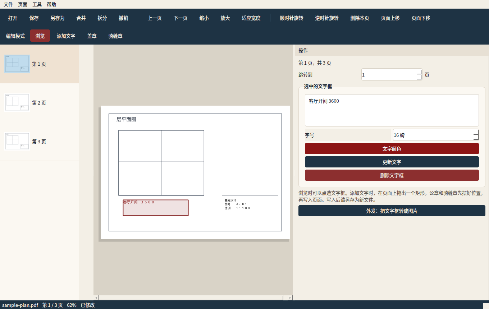
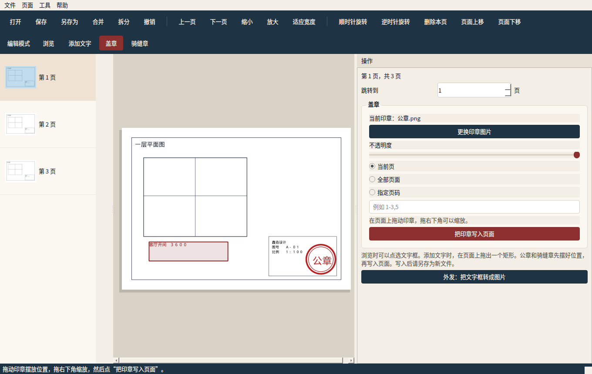
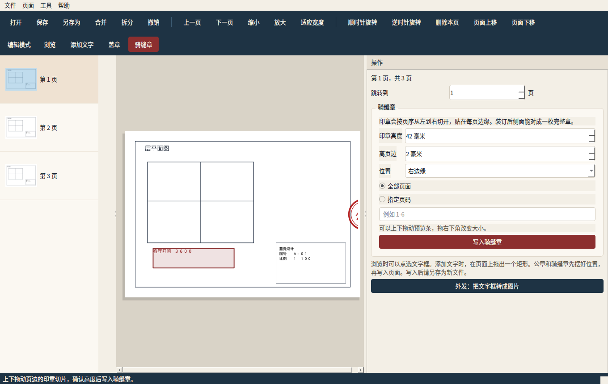

# 鑫垚设计PDF编辑器

给建筑设计图纸用的 Windows 桌面工具。可以打开并查看 PDF，合并、拆分、提取页面，在图上写文字，给页面盖 PNG 公章，也可以加骑缝章。文件都在本机处理，不会上传。

窗口标题是「鑫垚设计PDF编辑器」。界面是简体中文。

## 功能

1. **查看**：打开 PDF，上一页 / 下一页，跳转到指定页，放大、缩小、适应宽度，左侧缩略图。拖动缩略图可以调整页面顺序。
2. **合并**：按你排好的顺序把多份 PDF 合成一份。
3. **拆分与提取**：按页码范围拆成多个文件（如 `1-3,5`），或每一页单独存成一个文件，或按填写顺序提取页面到一个新文件。
4. **编辑**：在页面上拖出一个矩形，写入可换行的中文文字框；之后可以改字、改字号、改颜色、拖动位置或删除。可以顺时针 / 逆时针旋转页面，删除页面，上移或下移页面。这些操作都可以撤销。
5. **公章**：选择透明 PNG（也支持 JPG 等常见图片），在预览上拖动、缩放，再选择当前页、全部页或页码范围写入。可以调不透明度。
6. **骑缝章**：把同一枚章从左到右竖切，按页序贴在每页左边缘或右边缘。装订后从侧面能对成一枚完整的章。至少两页。高度、离页边的距离和上下位置可以调。

文字框会记在 PDF 里，用本程序再次打开还能改。公章和骑缝章写入页面内容，保存之后不能再拖动，需要的话先撤销，或重新盖一枚。

## 界面

浏览，并选中一个文字框：



盖章：把 PNG 公章拖到图签附近，再写入页面。



骑缝章：右侧页边是当前页分到的那一条。



## 技术选型

先对照了现成项目和库，再决定自己做一层较薄的中文界面，而不是从零写 PDF 引擎，也没有去分叉一个大项目。检索时间是 2026 年 11 月。

| 项目 | 情况 | 没有直接采用的原因 |
| --- | --- | --- |
| [PyMuPDF](https://github.com/pymupdf/PyMuPDF) | 约 1.1 万 star，AGPL-3.0，Artifex 维护，2026-10-31 仍在更新 | 选它做引擎。桌面程序固定在 1.28.2，不使用 2.0：2.0 会带上 onnxruntime、numpy 等版面分析依赖，和盖章、拆分无关，安装包会大很多 |
| [PySide6](https://pypi.org/project/PySide6/) | Qt 官方 Python 绑定，LGPL-3.0 或 GPL | 选它做界面，Windows 上能打成单个 exe |
| [pypdf](https://github.com/py-pdf/pypdf) | 约 1.0 万 star，BSD-3-Clause，合并拆分很稳 | 没有和 MuPDF 同级的页面渲染，文字和透明图章要再接一套库 |
| [pdf.js](https://github.com/mozilla/pdf.js) | 约 5.4 万 star，Apache-2.0 | 只负责显示，改页面还得另配库 |
| [pdf-lib](https://github.com/Hopding/pdf-lib) | 约 8.7 千 star，MIT，最后一次提交停在 2024-07 | 能画图、合并，但不能很好地改已有内容；维护已经停了 |
| [pypdfium2](https://github.com/pypdfium2-team/pypdfium2) | 约 850 star，Apache-2.0 / BSD | 渲染许可宽松，但改注释、嵌图、中文文字都比较底层 |
| [Stirling-PDF](https://github.com/Stirling-Tools/Stirling-PDF) | 约 9.5 万 star，开源核心加专有模块 | 是网站和服务器那一套，不是给小团队用的轻量 Windows 程序。骑缝章要在那个仓库里改，成本高，许可证也更绕 |
| PDFree、Opiter、Open-Source-PDF-Editor | 都是 PyMuPDF + PySide6 的桌面程序，AGPL；star 大约是 2、0、12 | 体量小，没有公章拖放和骑缝章。分叉之后仍要重做中文界面，不如直接用同一套成熟库写清楚需要的功能 |

程序因此分成两层：`xy_pdf/core` 只用 PyMuPDF 和 Pillow，测试不打开窗口；`xy_pdf/ui` 是 PySide6 界面。

### 许可证

- **PyMuPDF 是 AGPL-3.0。** 本程序链接了它，所以整个程序也按 **AGPL-3.0** 发布，全文在 [LICENSE](LICENSE)。获得 exe 的人有权拿到对应源代码，就是这个仓库。
- **只在公司自己的电脑上使用、不把程序交给外面的人**，一般不构成 AGPL 里的“发行”，不必因此公开公司其他项目的代码。
- **把 exe 发给客户、放到网站上，或做成别人能连上来用的服务**，就要按 AGPL 提供完整源码。GitHub Release 上的 exe 以本仓库为对应源码。
- 如果以后要做成闭源软件再对外发，需要向 Artifex 购买 PyMuPDF 商业许可，不能继续用这份 AGPL 构建。
- **PySide6 / Qt** 是 LGPL-3.0（或 GPL）。这里没有改 Qt 源码。因为整个程序已经按 AGPL 公开源码和构建方式，收到程序的人可以自己换一套 Qt。详见 [NOTICE.md](NOTICE.md)。
- Pillow 是宽松许可，只用来处理公章图片。

这是选型说明，不是律师意见。对外商业分发前，建议再让人看一下 AGPL 和 Qt LGPL 是否符合公司打算。

## 下载与安装

发布标签（例如 `v1.0.0`）推上去之后，GitHub Actions 会在 Windows 上跑测试、打出一个便携版 `XinyaoPDFEditor.exe`，并挂到该标签的 Release 上。

1. 打开本仓库的 Releases。
2. 下载 `XinyaoPDFEditor.exe`。不需要单独安装 Python。
3. 双击运行。窗口标题是「鑫垚设计PDF编辑器」。

没有杀毒软件误报时，不用安装，拷到任意文件夹就能用。第一次启动会解压临时文件，稍等几秒。

也可以在 Actions 里手动运行「Windows 构建」，从构建产物里下载 exe。拉取请求上的构建同样会上传产物，但不会新建 Release。

## 使用说明

- **打开 / 保存**：文件 → 打开，或工具栏「打开」。改完后用「另存为」存成新文件，避免盖掉原图。带密码的 PDF 打不开，需要先去掉密码。
- **翻页和缩放**：上一页、下一页，右侧「跳转到」，或按 Page Up / Page Down。Ctrl 加滚轮也可以缩放。缩略图单击即可跳转。
- **合并**：工具栏「合并」。添加文件，用上移 / 下移调顺序，需要的话勾上「把当前打开的文档放在最前面」，然后选择保存位置。
- **拆分**：工具栏「拆分」。
  - 按范围：`1-3,5,8-10` 会生成多份，逗号是一份文件的分界。中文逗号也可以。
  - 每一页一个文件。
  - 提取：`4,2` 会按这个顺序做成一个新 PDF。
- **文字**：编辑模式选「添加文字」，在图上拖出一个矩形，输入文字。点虚线框可以改字；拖动虚线框可以挪位置；Delete 键删除。Esc 回到浏览。
- **旋转、删页、排序**：工具栏上的旋转、删除本页、页面上移 / 下移。也可以直接拖左侧缩略图排序。
- **盖章**：编辑模式选「盖章」，选择 PNG。拖动改变位置，拖右下角改变大小，选好页面后点「把印章写入页面」。
- **骑缝章**：编辑模式选「骑缝章」。默认贴在右边缘、高约 42 毫米、离页边 2 毫米。可以上下拖动预览条。确认后点「写入骑缝章」。页序按文档从前往后，不按输入时的先后。
- **外发**：如果对方电脑没有中文字体，菜单「工具 → 文字转图片」会把文字框画成图片再写入，常见阅读器都能看见。转完就不能再当文字编辑。
- **撤销**：工具栏「撤销」，或 Ctrl+Z。特别大的文件（约 40MB 以上）为了省内存，可能无法撤销。

## 从源码构建

需要 Python 3.11 或以上，下面按 3.12 来写。在 Windows 上：

```bat
python -m venv .venv
.venv\Scripts\activate
pip install -r requirements.txt -r requirements-dev.txt
python main.py
```

打成和 Release 一样的单个 exe（在仓库根目录执行）：

```bat
pyinstaller --noconfirm --clean --windowed --onefile --name XinyaoPDFEditor --icon assets\app.ico --collect-all pymupdf --collect-all PySide6 --collect-all PIL main.py
```

生成的文件是 `dist\XinyaoPDFEditor.exe`。

Linux 或 macOS 上也可以 `python main.py` 运行界面，自动化发布只做了 Windows exe。

## 测试

核心操作不依赖窗口：

```bat
pytest
```

覆盖合并顺序、按范围拆分、逐页拆分、提取、文字框的新增 / 修改 / 删除 / 再次打开、旋转页面上的文字、删页和重排、撤销、公章位置、旋转页上的公章方向、骑缝章分色，以及加密文件拒绝打开。

## 已知限制

- 不能像改 Word 那样重排 PDF 里原有的正文，只能新增文字框。原有正文仍留在页面上。
- 新增文字使用 MuPDF 自带的简体中文宋体，不会把一整套字体嵌进文件，所以文件较小，本程序里一定能看见。对方如果用没有中文字体的阅读器，这些字可能不显示。外发前可以用「文字转图片」。
- 文字框不要互相重叠。带浅色底的文字框在修改时，会清掉完全落在这个框里面的矢量线条。
- 公章和骑缝章保存后是页面上的图，不能再选中拖动。
- 骑缝章按整页高度方向放置，适合按页序装订的图纸。少于两页不能做。
- 不支持加密 PDF，也不做电子签章证书。
- 页面删掉或重排之后，书签会按新页码尽量保留，复杂跳转可能变成只跳到那一页。
- 撤销栈最多大约 8 步，并且跳过特别大的文件。

## 目录

```text
main.py                 启动
xy_pdf/core             合并、拆分、文字、公章、骑缝章
xy_pdf/ui               简体中文界面
tests                   pytest
.github/workflows       Windows 测试与打包
```
